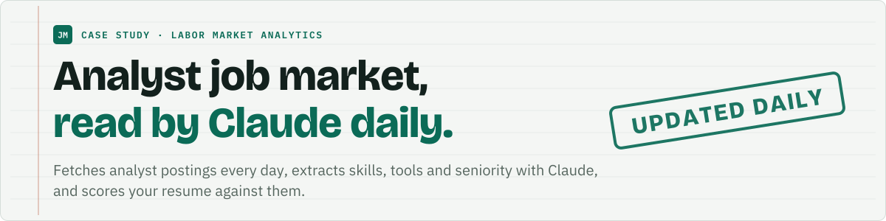
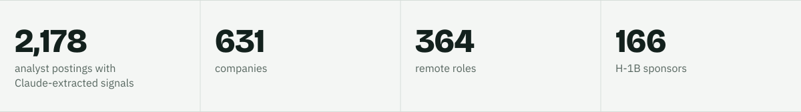
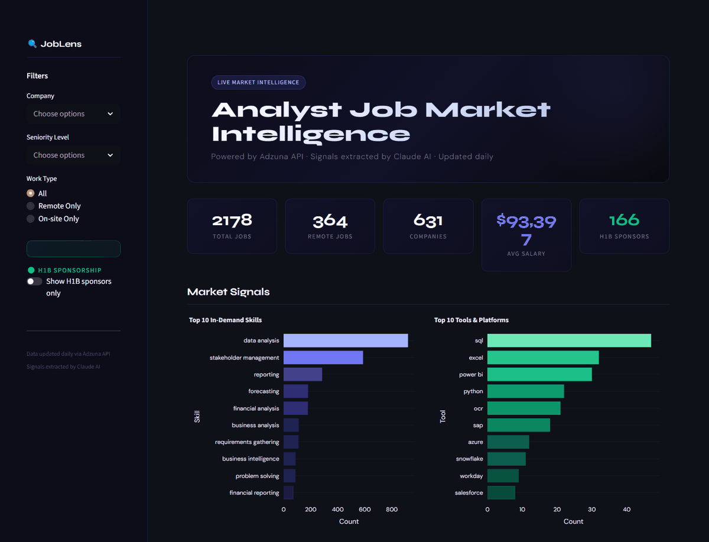
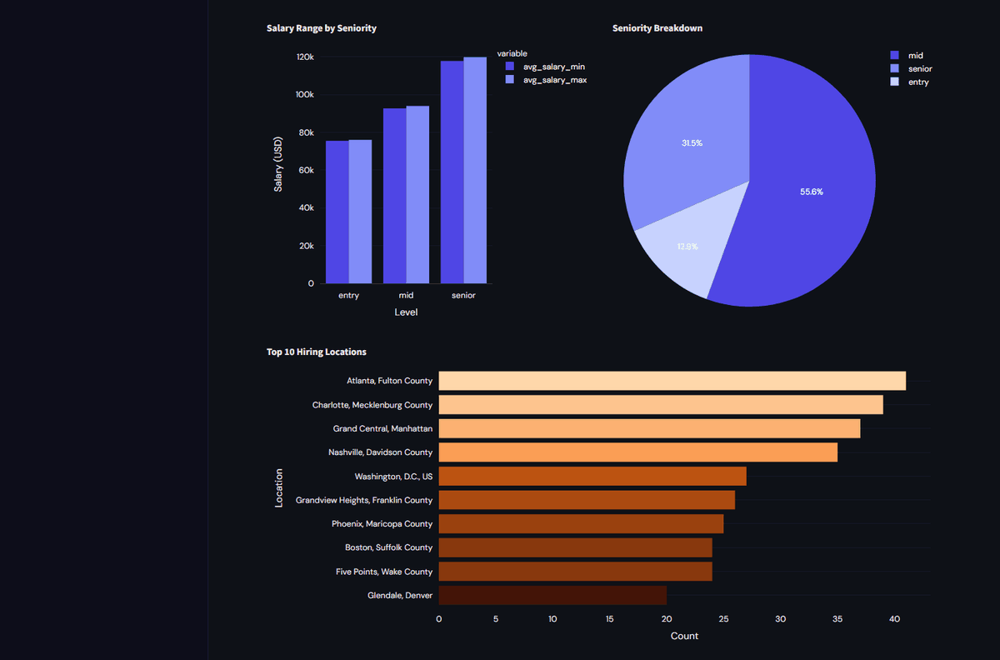

<picture>
  <source media="(prefers-color-scheme: dark)" srcset="assets/banner-dark.svg">
  
</picture>

<p>
<a href="https://job-market-intelligence-mingqywwbfrae7gkpxappfe.streamlit.app/">
<picture>
  <source media="(prefers-color-scheme: dark)" srcset="assets/btn-live-app-dark.svg">
  
</picture>
</a>
&nbsp;
<a href="https://ebrahimtahirr.github.io/ap-agent-site/">
<picture>
  <source media="(prefers-color-scheme: dark)" srcset="assets/btn-ap-case-study-dark.svg">
  
</picture>
</a>
</p>

<sub>Live app: <a href="https://job-market-intelligence-mingqywwbfrae7gkpxappfe.streamlit.app/">https://job-market-intelligence-mingqywwbfrae7gkpxappfe.streamlit.app/</a> (free hosting: if it shows "gone to sleep", click the wake button and give it a minute). The AI features (briefing and resume scorer) are paused in the public demo; the charts, filters and H-1B toggle are live.</sub>

<picture>
  <source media="(prefers-color-scheme: dark)" srcset="assets/stats-dark.svg">
  
</picture>

## Problem

Job postings are long, unstructured text. Seeing which skills, tools and seniority levels the analyst market actually asks for, and which employers sponsor H-1B visas, means reading thousands of them. This pipeline turns the postings into structured signals and puts them in one dashboard, and lets a candidate compare a resume against the same data.

## Approach

1. **Fetch.** Pulls Data Analyst, Business Analyst, Market Insights, Strategy, Reporting, Operations, Financial and Product Analyst postings from the Adzuna API (8 search terms, 5 pages of 50 results each per run).
2. **Extract.** Claude reads each description (first 3,000 characters) and returns JSON: up to 6 skills, up to 6 named tools, years of experience, remote or not, and seniority.
3. **Enrich.** Postings are matched against USCIS H-1B data (employers with at least one initial approval, 2023 export) and labelled as sponsors.
4. **Store and schedule.** Everything lands in SQLite (`jobs.db`). `scheduler.py` repeats fetch and enrich every 24 hours.
5. **Show.** A Streamlit dashboard ("JobLens") with filters by company, seniority, work type and H-1B sponsorship; a daily market briefing written by Claude on each load; and a job fit scorer: upload a resume PDF and Claude scores every job in the database and returns the top 5 matches with ATS keywords, or paste any job description for an instant match score and resume tips.

## Result

The live dashboard currently shows:

| Signal | Value |
|---|---|
| Postings with Claude-extracted signals | 2,178 |
| Companies | 631 |
| Remote roles | 364 |
| H-1B sponsors | 166 |
| Seniority mix (where stated) | 55.6% mid, 31.5% senior, 12.9% entry |

Top skills in the data include data analysis, stakeholder management and reporting; top tools include SQL, Excel, Power BI and Python.

## Stack

Python, Claude API, Adzuna API, SQLite, Pandas, Plotly, Streamlit, `schedule`.

## Screenshots

<p></p>

<p></p>

## How to run

```bash
pip install -r requirements.txt
```

Create a `.env` with `ANTHROPIC_API_KEY`, `ADZUNA_APP_ID` and `ADZUNA_APP_KEY`, then:

```bash
python pipeline.py       # fetch postings
python enricher.py       # extract signals with Claude
python h1b.py            # label H-1B sponsors
streamlit run dashboard.py
```

`python scheduler.py` runs fetch and enrich every 24 hours.
